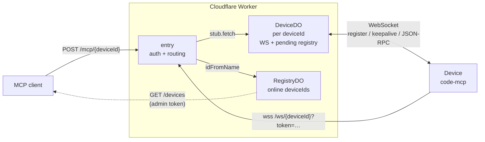

# Code MCP

**Give AI agents your machine's files and shell as MCP tools - locally, or from anywhere through a gateway.**

[](https://github.com/Tuanm/code-mcp/actions/workflows/ci.yml)

**Get started:** [code-mcp.tuanm.workers.dev](https://code-mcp.tuanm.workers.dev) (also on [GitHub Pages](https://tuanm.github.io/code-mcp/)) - download `mcp` for your platform and run `mcp connect`.

| Folder | What it is |
| --- | --- |
| [`code-mcp/`](code-mcp) | **code-mcp**, the MCP server that runs on a machine and exposes its files and shell as tools - in TypeScript (Bun). It serves locally, or connects out to a gateway as a *device*. |
| [`gateway/`](gateway) | **Prime**, a Cloudflare Worker that relays MCP clients to devices anywhere: per-device authentication, anonymous devices, an admin page, temporary file storage. |
| [`cli/`](cli) | **`mcp`**, the command line client: connect this machine as a device (it embeds code-mcp), run code-mcp as a user service, list and call device tools, and serve every device's tools as one MCP server. |
```text
MCP client --POST /mcp/{device}--> gateway/ <--WebSocket-- code-mcp/ (run by mcp connect / mcp service)
```

## Gateway properties

| Property | How it is achieved |
| --- | --- |
| **Global & auto-scaling** | Runs on Cloudflare Workers; every isolate routes to the same Durable Object per `deviceId` |
| **Secure** | Per-device tokens on both the device WebSocket and the MCP relay; `/devices` is never public; unknown ids return 401 (no existence oracle); admin UI behind Cloudflare Access |
| **Long tool calls** | Durable Objects have unlimited wall time while the client is connected; `TIMEOUT_MS` defaults to 300 s |
| **Zero servers** | No VM to patch or scale; Durable Objects hibernate when idle (WebSocket Hibernation API) |

## How it works


- A device connects once via WebSocket; its tunnel and pending requests are owned by one Durable Object, so any isolate can serve `/mcp` requests for it.
- Authentication happens **before** any Durable Object is created — unauthenticated probes cost nothing and reveal nothing.
- `GET /devices` is hidden (404) when no admin token is configured, and admin-gated (401) otherwise.

## Quick start
```bash
cd gateway
npm install
npx wrangler secret put DEVICE_TOKENS    # JSON map, e.g. {"my-device":"my-secret"}
npx wrangler secret put ADMIN_TOKEN      # optional: gates GET /devices
npx wrangler deploy
```

| Endpoint | Purpose |
| --- | --- |
| `wss://<worker>/ws/<deviceId>?token=<deviceToken>` | Device connects to its tunnel |
| `POST <worker>/mcp/<deviceId>?token=<deviceToken>` | MCP client relays a JSON-RPC call |
| `POST <worker>/api/files?name=&expiry_days=&key=` | Upload a temporary file (device Basic auth; streamed into R2) |
| `GET <worker>/api/files/{id}` | Download it (supports `Range`) |
| `GET <worker>/files` | File management page (device Basic auth) |
| `GET <worker>/mcp` | Sandbox: the browser as a device with JavaScript tools (device Basic auth) |

## Temporary files

Devices can park temporary files on the gateway and share a link:
```bash
curl -u demo:demo --data-binary @report.pdf \
  "https://code-mcp.tuanm.workers.dev/api/files?name=report.pdf&expiry_days=7"
```

Auth is HTTP Basic with the device's own `deviceId`/`token` (the pair
registered at `/admin`). A protected file's key is passed as the
`X-File-Key` **request header**, never in the URL, so it cannot end up in an
access log or a `Referer`. Limits: 200 MiB per file, 7 days, 5 files and
500 MiB per device. Expired files are deleted automatically and never listed.
Requires an R2 bucket bound as `BUCKET` - see
[gateway/README.md](gateway/README.md#temporary-files).

## Sandbox: this browser as a device

`GET /mcp` (HTTP Basic with a registered device's id and token, like `/files`)
turns the browser tab into that device. Instead of files, it holds **tools**:
JavaScript files, one tool each, kept in the browser's storage.
```js
/**
 * Add two numbers.            <- the tool's description
 * @param {number} a First     <- arguments and their JSON schema
 * @param {number} [b=1] Second
 */
export default async function add(a, b = 1) { return a + b; }
```

- **Manage**: `+` adds a .js file; Save validates it (syntax, a single default
  async function, no imports, `@param` tags matching the parameters, supported
  types, unique name). View (edit), Download, Deactivate/Activate, Delete. On a
  first visit with no tools, starter tools for building a dashboard are added
  (`dashboard_add/update/list/remove/events`, `ask_user`, `confirm`,
  `bar_chart`, `table`, `increment` - a handler example - `cursor_click`,
  `cursor_type`) - delete what you do not need.
- **Connect** opens the device's tunnel (WSS, authorised by a 30-second,
  single-use ticket - the token never goes in a URL). Tools are locked while
  connected. MCP clients reach it at `/mcp/{deviceId}` like any device and see
  exactly two tools: `search` (find tools, with their schemas) and `call`
  (`{name, arguments}`).
- **Dash**: while connected, tools can show UI - `ui.add({type, ...})` with
  heading, text, code, image, editor, button, input, textarea, checkbox,
  select, slider, status, divider, row, card - rendered by the page in its own
  style, and drive a **named cursor per MCP client** (`cursor.click`, `type`,
  `fill`, `check`, `select`, `drag`). `ui.wait(id)` waits for the person at the
  browser to click or change something. The page's *Components* section shows
  every component with its `ui.add` call.
- **Event handlers**: `on: { click: { tool, args } }` (or `change`) on a
  component runs that sandbox tool on every click or change - by the person or
  by a cursor - with the details as `event`, so a dashboard stays interactive
  without an agent. `ui.events({ since, timeout })` returns what happened (who
  clicked what, which handler ran) for agents to react to. Every control is
  drawn by the page - no native select, checkbox, range or dialogs - with
  keyboard support.
- **Isolation**: each call runs in its own iframe sandboxed by attribute and
  CSP - an opaque origin with no storage, cookies or credentials, no network,
  no access to the page - and is stopped after 120 s. Clients are told apart by
  the `Mcp-Session-Id` the gateway now issues on `initialize`; devices receive
  `client: {id, name}` with each request (the id is a salted hash, not an IP).
- One tunnel per device: if the device is already connected elsewhere (e.g.
  code-mcp), Connect says so instead of replacing it. Closing the tab
  disconnects.

## code-mcp

`code-mcp/` holds the device server, `code-mcp.ts` (Bun - the one the CLI embeds). See [code-mcp/README.md](code-mcp/README.md).
```bash
bun code-mcp/code-mcp.ts --port 7777 --token secret           # a local MCP server
bun code-mcp/code-mcp.ts --gateway --id my-laptop --token t   # a device on the gateway
```

## CLI

`cli/` builds `mcp`, a fast, dependency-free command line client: connect this
machine as a device, run code-mcp as a service, list and inspect tools, and
call one or many tools from inline JSON, paired arguments or stdin.
```text
mcp connect                                    # this machine, as an anonymous device
mcp service install --id my-laptop --token t   # ...or a registered one, at every login
mcp devices connect my-laptop --token dev-secret --gateway https://gw.example.dev
mcp tools list my-laptop
mcp tools call my-laptop.read '{"path":"README.md"}'
claude mcp add devices -- mcp serve            # every device's tools as one MCP server
```

Credentials and defaults live in `~/.code-mcp-gateway/config.yaml`; flags override
environment variables, which override the device entry, which overrides the
defaults section. `mcp --help` lists everything, and `mcp call` is an alias for
`mcp tools call`.

## Documentation

- [code-mcp/README.md](code-mcp/README.md) - code-mcp: tools, flags, the implementation
- [cli/README.md](cli/README.md) - the `mcp` CLI: install, commands, configuration, exit codes
- [gateway/README.md](gateway/README.md) — architecture, security model, deploy, tunables, test
- [gateway/src](gateway/src) — entry point, DeviceDO, RegistryDO, config
- [MCP specification](https://modelcontextprotocol.io) — the JSON-RPC protocol this gateway transports

## Development
```bash
cd gateway && npm test            # unit, smoke, file storage, anonymous devices (local wrangler)
cd gateway && npm run typecheck
cd cli && bun run test && bun test/e2e.ts      # CLI unit + end-to-end, against a local gateway
cd cli && bun test/service-e2e.ts              # mcp service on this OS's real service manager
cd code-mcp && python -m unittest discover -s tests   # launcher tests
```

CI runs each component's suites when it, or something it depends on, changes:
the gateway on Linux; the CLI on Linux and Windows (x64, Arm) plus `mcp service`
on Linux, macOS and Windows; code-mcp on Linux, macOS and Windows.

Device-issued files can also be downloaded through authenticated
`GET /mcp/{deviceId}/download/{ticket}` with `X-Device-Token` and gateway
credentials. See [download protocol and curl usage](gateway/README.md#ticket-based-file-downloads).
