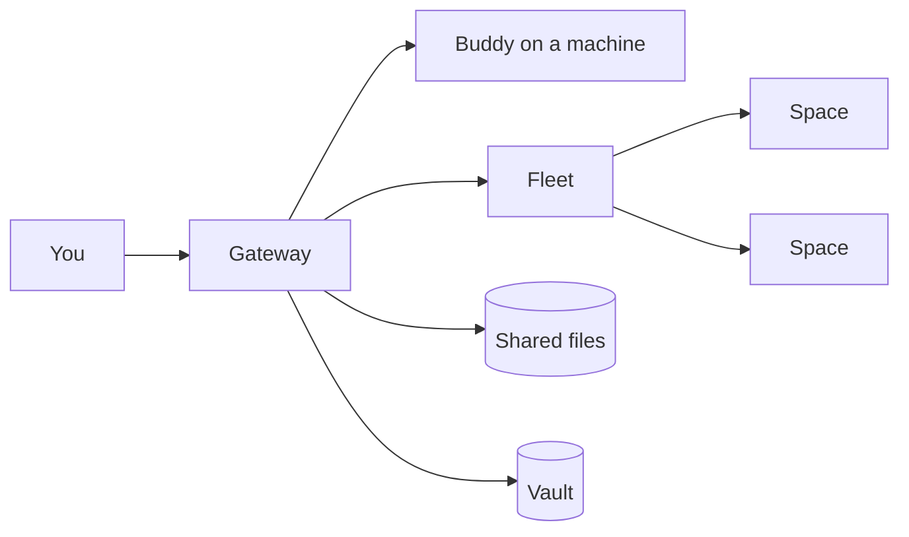

# Prime

**A light toolkit for secure execution environments.**

[](https://github.com/Tuanm/prime/actions/workflows/ci.yml)

Any machine becomes a buddy in your team: its files and its shell, reachable from
anywhere, with nothing opened to the network. A few of them can be one team - a
fleet. A space is a workspace you can make in a moment, keep for as long as you
like, and put in a fleet.



The gateway never opens a port on your machine. The machine makes one connection
out, and it lasts only while the machine is running. Everything else - a client, a
browser page, another machine - comes in through the gateway.

## Start

Three commands and a page:

```bash
prime connect                        # this machine, as a buddy
prime connect --id my-laptop         # ...or a named one, on the gateway
prime files upload report.pdf        # hand a file to someone
```

Then open `/connect` for the download button and the platform list, `/files` to
manage what this machine holds, `/sandbox` for a tool that runs in the page, and
`/join` for what a fleet is.

## What you can do

### Reach a machine from anywhere

```bash
prime tools list my-laptop           # what it exposes
prime tools call my-laptop.bash '{"command":"git status"}'
prime serve                          # every buddy as one server, for a client that knows one
```

A buddy exposes its files, its shell, search, jobs and a preview window. A tool
call can run for minutes: the connection survives, and a call whose client went
away is cleaned up instead of leaking.

### Share a file

```bash
prime files upload report.pdf        # prints a link
prime files list                     # sizes, dates, protection
prime files download report.pdf -o copy.pdf
```

A link can carry a key, passed as a request header - never in the URL - so it
cannot leak through an access log. Two hundred mebibytes per file, seven days,
five files and five hundred mebibytes per buddy. Expired files are deleted, not
listed.

### Run a space

```bash
prime spaces create --name dev                 # ephemeral: stop wipes it
prime spaces create --name work --persistent   # keeps /root/work across stop and start
prime spaces list
prime spaces top dev                           # live cpu and memory
```

A space is a rootless Linux container with its own network and its own limits. On
macOS it runs in Apple's container micro-VM, on Linux in rootless podman, so root
inside a space is not root on the machine. Nothing of your filesystem is mounted
into it and no docker socket is shared with it.

### Keep a secret

```bash
prime vaults init                          # once, per machine
prime vaults company add acme
prime vaults set acme secret api_token --stdin
prime vaults list acme
prime vaults code acme two_factor          # a TOTP code, current
```

A vault is encrypted at rest and belongs to a space: the run tool opens it for a
single call and the value never appears in the command line.

### Put them in a fleet

```bash
prime fleets create acme             # the operator makes the fleet
prime fleets invite acme             # a code that works once, for ten minutes
prime fleets join acme --code p1_... # a space asks to join
prime fleets approve acme --member <id>
prime fleets members acme
```

A fleet is one piece of work kept in step on several machines. One of them is in
charge at any moment, the others keep an identical copy, and if the one in charge
goes quiet another takes over with the work already there. A job sent to the fleet
reaches whichever one is answering.

## Use cases

- **A build machine you can only reach through the gateway.** Connect it once,
  call its shell from a laptop in a café, share the artifact with a link.
- **Three machines, one project.** A fleet keeps the same repository on each; a
  long job started on one carries on where it lands when that machine goes to
  sleep.
- **A tool that runs in a page.** `/sandbox` runs the JavaScript you write with no
  access to your cookies or storage - handy on a machine you do not trust.
- **A throwaway Linux box.** `prime spaces create --name dev` in a second, gone
  when you stop it.

## Security, in short

- Nothing listens on your machine; the only connections are ones it makes.
- Every request carries an id and a token, checked before anything moves.
- What the gateway stores for a space is sealed for that space's key.
- A space is rootless, in its own network, with no host folder and no socket.

The [Security page](https://prime.tuanm.workers.dev/security) says it at length,
including what it does not do: nothing here helps with a machine that is already
compromised.

## Who it is for

An operator who keeps a few machines and wants them reachable without a VPN or an
open port, or who wants a disposable Linux box with an encrypted vault. The admin
page at `/admin` is the console: who is connected, who is in which fleet, what the
month has cost.

## Where to read more

- [Join](https://prime.tuanm.workers.dev/join) - what a fleet is, with a picture
- [Security](https://prime.tuanm.workers.dev/security) - what it does, and what it cannot
- [docs/fleets.md](docs/fleets.md) - fleets in detail: the lease, joining, failure
- [cli/README.md](cli/README.md) - the `prime` CLI: install, commands, configuration
- [cli/SERVER.md](cli/SERVER.md) - the buddy on the machine: flags and behaviour
- [api/README.md](api/README.md) - the gateway: endpoints, security, configuration

## Building it

```bash
cd api && npm test                    # the gateway
cd cli && bun run test                # the CLI and the buddy
```

CI runs the suite of whichever part changed, on the platforms it supports.
