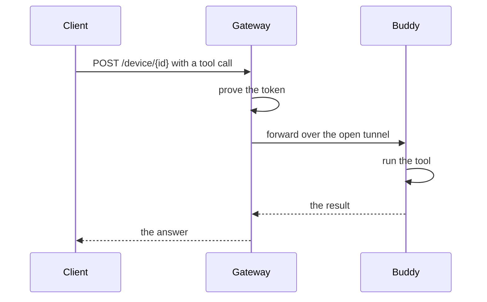
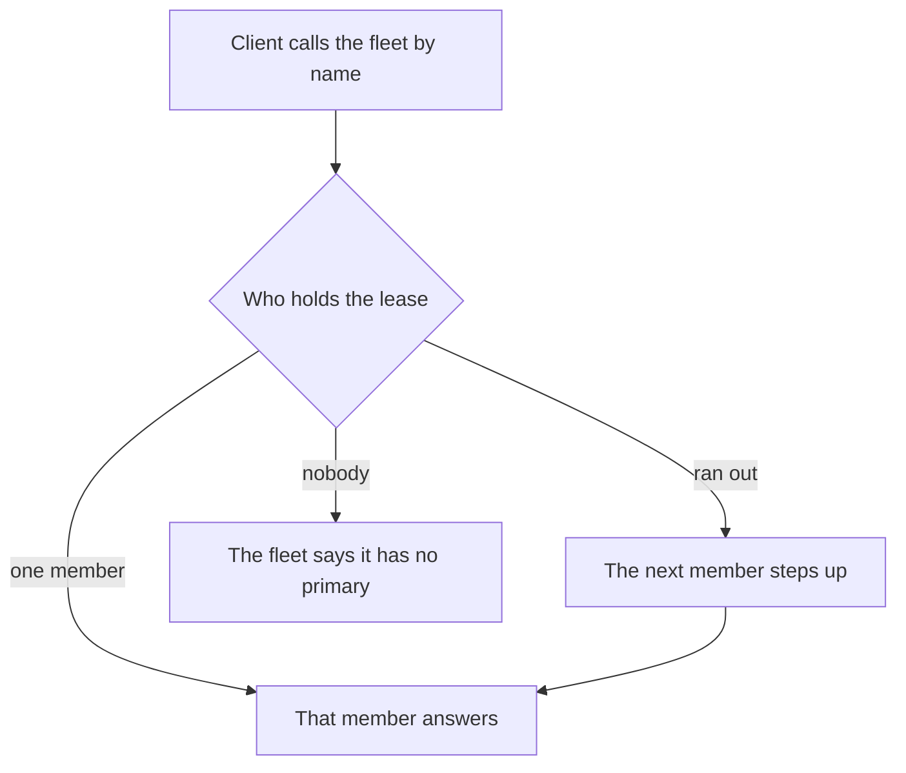

# Prime gateway

The gateway is the door between a tool call and the machine that runs it. A buddy connects out once, the gateway holds that one tunnel, and every call for that buddy goes down it and comes back with an answer.

## How a call travels

Nothing on your machine listens to the network. The buddy opens one connection out and keeps it. A client sends a tool call to the gateway over plain HTTP. The gateway proves the caller, finds the buddy's open tunnel, and passes the call down it. The buddy runs the tool and sends the result back. The client gets one HTTP answer and never learns where the machine sits.



A call may take its time. The tunnel waits, and the HTTP answer waits with it, up to five minutes by default. Only computation is billed, not waiting, so a build or a recording that takes minutes is an ordinary call.

## Who answers in a fleet

A fleet is a named group of spaces that hold the same work. One of them holds the lease and does the writing. The rest keep an identical copy and wait their turn.

A fleet is also a buddy. It has its own name and its own token, so a client calls the fleet and never one machine. The gateway asks the fleet which member holds the lease, then relays the call there. When that member goes quiet the lease runs out and another steps up, with the work already in step. A call made in the gap fails and says which member it could not reach.



The lease is renewed every five seconds and lasts fifteen, so a lost round or two is still a live primary. A space that is stopped, or switched off by the operator, gives the lease back at once. The member that takes it applies what it is missing before it writes, so a fleet never forks.

## Endpoints

Every endpoint is a URL the gateway answers. The paths below are the ones to use. Older aliases still answer, and the same way.

### Buddies

| Endpoint | Needs | What it does |
| --- | --- | --- |
| `POST /api/devices/anonymous` | gateway token if set | Create a throwaway buddy. The answer carries its id, its code and a connect URL. |
| `WS /device/ws/{deviceId}` | the buddy's token, or a one-use ticket | Open the tunnel the gateway keeps. |
| `POST /device/{deviceId}` | gateway token and the buddy's token | Carry one JSON-RPC call and return the answer. |
| `GET /device/sse/{deviceId}` | gateway token and the buddy's token | Open an event stream. The first event names the URL for posting calls. |
| `POST /device/messages/{deviceId}?session=` | gateway token and the buddy's token | Send one call over that stream. The answer arrives on the stream. |
| `GET /device/{deviceId}/download/{ticket}` | gateway token and the buddy's token | Download a file the buddy hands out by ticket. |
| `POST /device/{fleetId}` | the fleet's token | Send a call to whichever member holds the lease. |

The older paths `/mcp/{deviceId}`, `/sse/{deviceId}`, `/messages/{deviceId}` and `/ws/{deviceId}` are the same endpoints. A second connect from the same buddy replaces a tunnel that has gone quiet. It is refused while the old tunnel is still live.

### Pages

| Endpoint | Needs | What it does |
| --- | --- | --- |
| `GET /` | public | The front page. |
| `GET /connect` | public | Set up a buddy on this machine. |
| `GET /connect/{deviceId}` | the buddy's token | The sandbox page for that buddy. |
| `GET /sandbox` | the buddy's own credentials | Run a buddy in this browser tab. |
| `GET /join` | public | What a fleet is, told plainly. |
| `GET /security` | public | What the design does for you, and what it cannot. |
| `GET /files` | the buddy's own credentials | The file management page. |
| `GET /files/{id}` | public, or the file's key | The download page for one file. |
| `GET /mcp` | public | A redirect to the connect page. |

### Files

Files authenticate with the buddy's own id and token, over HTTP Basic. There is no separate secret to keep. Uploads are raw bytes and stream straight through, so a large file is never held in memory. A protected file travels with a key in the `X-File-Key` request header, never in a URL, so a key cannot reach an access log, a browser history or a referrer. A link never carries the key either; send it separately, through a channel you already trust.

| Endpoint | Needs | What it does |
| --- | --- | --- |
| `POST /api/files?name=&expiry_days=` | the buddy's own credentials | Upload raw bytes and get the id and links back. |
| `GET /api/files` | the buddy's own credentials | What this buddy stores, and how much of its budget is spent. |
| `GET /api/files/{id}` | the buddy's own credentials, or the file's key | Download the file. Ranges are supported. |
| `PATCH /api/files/{id}` | the buddy's own credentials | Set or clear the file's key. |
| `DELETE /api/files/{id}` | the buddy's own credentials | Delete the file now. |

### Fleets

| Endpoint | Needs | What it does |
| --- | --- | --- |
| `GET /fleets` | gateway token | List the fleets. |
| `POST /fleets/{fleet}` | gateway token, or a buddy's token | Create a fleet. |
| `POST /fleets/{fleet}/join` | a buddy's token and the invite code | Ask to join. It waits until the operator admits it. |
| `POST /fleets/{fleet}/bootstrap` | a member's token | Take the lease or become a replica, in one step. |
| `GET /fleets/{fleet}` | a member's token | The roster. Ids are cut short for everyone but the operator. |
| `GET /fleets/{fleet}/head` | a member's token | Where the work has got to. |
| `POST /fleets/{fleet}/snapshot` | the primary's token | Publish a sealed pack and its manifest in one call. |
| `GET /fleets/{fleet}/packs/{hash}` | a member's token | Fetch a pack that is missing. |

### Operator

These need Cloudflare Access, unless the row says otherwise. The gateway verifies the Access assertion itself, so a broken Access application closes the page instead of opening it.

| Endpoint | Needs | What it does |
| --- | --- | --- |
| `GET /devices` | admin token | Which buddies are online. Hidden when no admin token is set. |
| `GET /admin` | Access | The operator page. |
| `GET /admin/api/devices` | Access | The whole registry, with tokens, state and where each buddy connects from. |
| `POST /admin/api/devices` | Access | Register a buddy or change its token. A new token drops the old tunnel. |
| `DELETE /admin/api/devices/{id}` | Access | Remove a buddy. |
| `POST /admin/api/devices/{id}/state` | Access | Switch a buddy off or on. Off drops its tunnel and its leases. |
| `GET /admin/api/devices/{id}/clients` | Access | Who called that buddy lately. |
| `POST /admin/api/devices/{id}/tools` | Access | The tools it exposes, fetched for the page so the token stays in the gateway. |
| `GET /admin/api/anonymous` | Access | Anonymous buddies by reference. Their ids and codes are never shown. |
| `POST /admin/api/anonymous/{ref}/state` | Access | Switch one off or on. |
| `GET /admin/api/anonymous/{ref}/clients` | Access | Who called it lately. |
| `POST /admin/api/anonymous/{ref}/tools` | Access | The tools it exposes. |
| `DELETE /admin/api/anonymous/{ref}` | Access | Delete it. |
| `GET /admin/api/fleets` | Access | Every fleet, its members, and who holds the lease. |
| `POST /admin/api/fleets/{fleet}` | Access | Create a fleet. |
| `POST /admin/api/fleets/{fleet}/invite` | Access | Mint a one-use invite code. |
| `POST /admin/api/fleets/{fleet}/approve` | Access | Admit a waiting buddy. |
| `POST /admin/api/fleets/{fleet}/remove` | Access | Take a member out. |
| `POST /admin/api/fleets/{fleet}/buddy` | Access | Set the fleet's own token. |
| `POST /admin/api/fleets/{fleet}/meta` | Access | Rename a fleet, or pause it. |
| `DELETE /admin/api/fleets/{fleet}` | Access | Delete a fleet. Its spaces are left alone. |
| `GET /admin/api/usage` | Access | What the month has cost so far. |
| `GET, POST, DELETE /admin/api/blocked` | Access | Block or unblock an address. |

## Security

**Every call is proved.** A buddy is an id and a token. The gateway checks both before it moves anything, on the tunnel and again on every call. A wrong pair gets a plain refusal, and an unknown id gets the same refusal, so nobody can tell a real buddy from a made-up one. A buddy that is switched off loses its tunnel at once, and a rotated token stops working at the next call. An address the operator blocks reaches nothing but the operator page.

**One tunnel, one buddy.** Each buddy has a place of its own. A tunnel can answer only the calls made to its own id, so a call can never land on the wrong machine.

**The gateway carries what it cannot read.** File contents are bytes it never inspects. A fleet's snapshots are sealed for the members' keys, so the gateway stores ciphertext it cannot open. It keeps no request log.

**The operator page has two gates.** Cloudflare Access proves who the person is. The gateway then verifies that assertion itself, so removing or breaking the Access application closes the page instead of exposing it. Listing the online buddies uses a token instead, and when no admin token is set that endpoint does not exist at all.

**Anonymous buddies are kept small.** A stranger can ask for a buddy and get a short code. That buddy is rate-limited harder, cannot store files, and locks for ten minutes after twenty wrong codes. A fleet invite is single use, short lived and stored as a hash, and nothing joins a fleet unnoticed: the operator admits each buddy by hand.

**A fleet call carries the primary's credential.** The gateway relays with the token of the member that holds the lease. Which member that is comes from a proven credential, never from a string the caller sends.

## Limits

| What | Limit |
| --- | --- |
| One call | 300 s, then the gateway stops waiting |
| Body of one call | 1 MiB |
| Calls in flight per buddy | 100 |
| Silence on a tunnel | 90 s, then it is dropped |
| Event streams per buddy | 32 |
| Buddies on the gateway | 100, anonymous included |
| Calls from one address | 100 per minute |
| Calls to an anonymous buddy | 30 per minute per address |
| New anonymous buddies | 5 per address per hour |
| One file | 200 MiB |
| One file's life | 7 days |
| Files per buddy | 5, and 500 MiB together |
| A ticket download | 100 MiB, 10 minutes, 4 at a time |
| Members in a fleet | 32 |
| An invite | 10 minutes, one use |

The rate limit counts in memory, so two copies of the gateway can each let a burst through. A Cloudflare rule on the address is the hard ceiling. A month's fleet budget is another ceiling: when it is spent, fleet calls answer 402 until it is raised or the month turns over.

## Three ways to run it

### A teammate needs the tools, not the laptop

Register the buddy in the operator page and give it a token. Hand over the token, not a login. When the work is done, change the token in the same place; the old one stops at the next call and the tunnel that used it is dropped.

```bash
prime devices connect my-laptop --token t        # keep the id and token on their machine
prime tools call my-laptop.bash '{"command":"git status"}'
```

### A build that runs for minutes

Start a buddy on the build machine, then let CI make one call. The answer waits while the build runs. Nothing is polled and nothing is queued. A call may run for five minutes by default; raise `TIMEOUT_MS` when the build needs longer.

```bash
curl -sS -X POST "https://YOUR-GATEWAY/device/build-box" \
  -H "Authorization: Bearer $GATEWAY_TOKEN" \
  -H "X-Device-Token: $DEVICE_TOKEN" \
  -H 'content-type: application/json' \
  -d '{"jsonrpc":"2.0","id":1,"method":"tools/call","params":{"name":"bash","arguments":{"command":"make -j8"}}}'
```

### A file that lives for a week

Files are for the handoff that is not worth a bucket of its own: a report, a log, a screenshot. Upload it, share the link, let it expire.

```bash
prime files upload report.pdf                    # a link that lasts a week
prime files list                                 # what is left, and when it goes
```

## Configuration

Set the secrets once and change the rest only when a machine or a call needs more room. Every default below is chosen to be safe.

```bash
npx wrangler secret put GATEWAY_TOKEN      # who may call the gateway
npx wrangler secret put DEVICE_TOKENS      # JSON map of buddy id to token
npx wrangler secret put ADMIN_TOKEN        # who may list the online buddies
npx wrangler deploy                        # publish the gateway
```

### Identity and access

| Variable | Default | What it does |
| --- | --- | --- |
| `GATEWAY_TOKEN` | unset | The token a client presents. When unset, the gateway is open. |
| `DEVICE_TOKENS` | unset | JSON map of buddy id to token. Preferred over one shared token. |
| `DEVICE_TOKEN` | unset | One token for every buddy, used when there is no map. |
| `ADMIN_TOKEN` | `GATEWAY_TOKEN` | Who may list the online buddies. With neither token set, that endpoint does not exist. |
| `ACCESS_TEAM_DOMAIN` | unset | The Access team whose assertion the gateway verifies. |
| `ACCESS_AUD` | unset | The Access application's tag. |
| `ADMIN_ACCESS` | `enforce` | `enforce`, `warn` or `off` for the Access check. |
| `VIRTUAL_DEVICE_IDS` | unset | Comma-separated ids the gateway answers itself, with no tunnel. |
| `VIRTUAL_DEVICE_TOKENS` | unset | JSON map of token for those ids. |

### The tunnel

| Variable | Default | What it does |
| --- | --- | --- |
| `TIMEOUT_MS` | `300000` | How long one call may run. |
| `MAX_BODY_BYTES` | `1048576` | The body cap for one call. A larger body is refused before it is read. |
| `MAX_PENDING_PER_DEVICE` | `100` | Calls in flight to one buddy. Over it, the gateway answers busy. |
| `KEEPALIVE_TIMEOUT_MS` | `90000` | Drop a tunnel after this much silence. |
| `PING_INTERVAL_MS`, `PING_MAX_MISSES` | `30000`, `2` | How often the gateway pings a buddy, and how many misses it allows. |
| `TUNNEL_REPLACE_GRACE_MS` | `5000` | An authenticated reconnect may take over a tunnel quiet for this long. |
| `IDLE_TIMEOUT_MS` | `120000` | How long a quiet tunnel may sit idle. |
| `RATE_LIMIT_WINDOW_MS`, `RATE_LIMIT_MAX` | `60000`, `100` | The in-memory limiter: calls per address per window. |
| `ALLOWED_ORIGINS` | unset | A comma-separated whitelist of browser origins for the tunnel. |
| `SSE_IDLE_TIMEOUT_MS` | `120000` | Close an event stream after this much quiet. |
| `MAX_SSE_SESSIONS` | `32` | Concurrent event streams per buddy. Over it, the gateway answers busy. |
| `ONLINE_TTL_MS`, `REGISTRY_REFRESH_MS` | `150000`, `30000` | How long a buddy counts as online, and how often it refreshes that. |

### Anonymous buddies

| Variable | Default | What it does |
| --- | --- | --- |
| `MAX_DEVICES` | `100` | Buddies the gateway holds, anonymous included. Ids the gateway answers itself do not count. |
| `ANON_DEVICES` | on | `off` turns anonymous registration off. |
| `ANON_RATE_LIMIT_MAX` | `30` | Calls per address per window for one anonymous buddy. |
| `ANON_CREATE_MAX`, `ANON_CREATE_WINDOW_MS` | `5`, one hour | New anonymous buddies per address. |
| `ANON_UNUSED_TTL_MS` | one hour | Delete an anonymous buddy that never connects within this time. |
| `ANON_IDLE_TTL_MS` | 7 days | Delete an anonymous buddy that has been offline this long. |
| `ANON_AUTH_MAX_FAILURES`, `ANON_AUTH_LOCK_MS` | `20`, 10 minutes | Wrong codes before an anonymous buddy is locked, and for how long. |

### Files and fleets

| Variable | Default | What it does |
| --- | --- | --- |
| `FILES_MAX_UPLOAD_BYTES` | 200 MiB | The size cap for one file. |
| `FILES_MAX_EXPIRY_MS` | 7 days | The longest life a file may be given. |
| `FILES_MAX_PER_DEVICE` | `5` | Live files one buddy may hold. |
| `FILES_MAX_TOTAL_BYTES` | 500 MiB | Bytes one buddy may store, expired files included until they are reaped. |
| `R2_BUDGET_USD_MONTH` | `5` | The monthly ceiling on file storage spend. An upload that would pass it answers 507. |
| `R2_FREE_STORAGE_GB` | `10` | The free storage the budget assumes before it charges for any bytes. |
| `FLEET_MONTHLY_BUDGET_USD` | `20` | The monthly ceiling on running fleets. Past it, fleet calls answer 402. |
