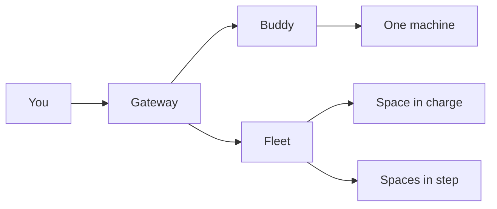
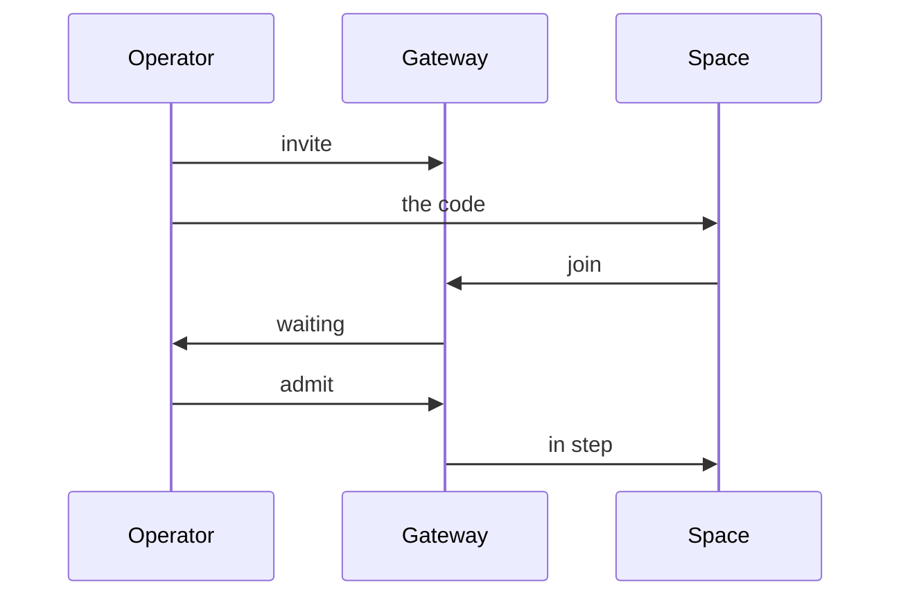

# prime

prime is the command line for a buddy: a machine of yours that offers its files and its shell as tools, reachable from anywhere through a gateway. From the same small binary you also run a space, share a file, keep a vault, and hold a fleet together.

## How the pieces fit

A buddy connects out to the gateway and stays connected. Nothing on it opens a port, so there is nothing to forward and no firewall rule to add. The connection lasts while the buddy runs.

The gateway is the one address in front of it. You present a token. The gateway carries the request, and the answer comes back the same way. What it keeps for a buddy is sealed for that buddy's own key, so the gateway carries the work without opening it.



A space is a workspace in a rootless container that runs a buddy of its own, with no gateway. A fleet is a few spaces that hold the same work: one is in charge and the others keep a copy, so a job carries on when a machine goes quiet. A client reaches a fleet as one device.

## Install

Build from source with Bun:

```bash
bun run build        # one file for every platform
bun run build:host   # only this machine, much faster
```

Each build writes one self-contained file per platform: macOS and Linux on arm64 and x64, Windows on x64 and arm64. The runtime travels inside, so a file runs on a machine with no Bun installed. That is why it is large: about 90 MB on a Mac and 100 to 120 MB on Linux and Windows.

Where Bun 1.2 or newer is already present, the JavaScript bundle is the leaner choice. It is a few hundred kilobytes and carries the same buddy.

A command is one request to the gateway, and the binary starts in about ten milliseconds, so it is cheap to call from a script.

Put the file on your path under the name `prime`, then check it:

```bash
prime --version
```

## On each platform

A buddy works the same everywhere. Three things differ: how it starts at login, how a space runs, and where the logs go.

| Platform | At login | A space runs on | Logs |
| --- | --- | --- | --- |
| macOS | a launch agent | Apple's container micro-VM | a log file for the service |
| Linux | a systemd user service | rootless podman | `journalctl --user -u code-mcp` |
| Windows | a scheduled task at logon, no admin rights, no window | WSL2 | a log file beside the config |

On Linux a user service stops at logout unless lingering is on. `prime service install` says so when it is off.

A service starts with almost no environment, so `install` carries the proxy settings of the shell it ran in and trusts the operating system's certificate store. On a network that inspects TLS the buddy still reaches out. If it reports a handshake failure, set `NODE_EXTRA_CA_CERTS` to your organisation's root and install again.

Under WSL2 a space needs a user systemd session for its limits, or the fallback runtime. `prime spaces doctor` says which piece is missing.

## Connect a machine

`prime connect` registers this machine as an anonymous buddy, saves it, prints its id, its six-character code and a connect URL, then runs the buddy in front of you. Ctrl-C stops it, and the command exits with the buddy's status.

```bash
prime connect                                    # this machine, managed gateway
prime connect --gateway https://gw.example.dev   # another gateway
prime connect --new                              # ask for a fresh buddy
prime connect --no-start                         # register and print, run nothing
prime connect -- --enable-memory                 # pass a flag to the buddy itself
```

Keep the code and the URL as carefully as a password: they grant shell access to this machine. An anonymous buddy also has a lower request budget and no file storage.

The buddy is remembered per gateway, so the next `prime connect` is the same one. A buddy the gateway no longer knows is replaced with a new one, and the note says so. A buddy the operator switched off is reported, and nothing is replaced. An unused anonymous buddy is deleted after about an hour, and one offline for seven days after that.

A registered buddy is saved once and reused the same way:

```bash
prime devices connect my-laptop --token dev-secret --gateway https://gw.example.dev
prime devices connect laptop --set-default      # also store these as the defaults
prime devices list                              # what is connected, and how fast
prime devices status my-laptop                  # one ping, with a round trip
prime devices disconnect my-laptop              # forget it here, not on the machine
```

Anything you leave out falls back to the environment, then the buddy's entry, then the defaults, so a full connect once makes every later one a single line. Running connect again merges: a token already stored is kept, not cleared.

To keep a buddy at login:

```bash
prime service install                              # the options from your config
prime service install --port 7788 --enable-memory  # with overrides
prime service status
prime service uninstall
```

`install` waits until the service has stayed up before it reports success. With a device id it also waits for the buddy to be online. No credential is written into a service definition or a command line; the service reads your config at every start. Run `install` again to apply a change.

## Call a tool

`prime tools list` shows what a buddy offers. `prime tools view` prints one tool's arguments and a ready call. `prime call` is the same command with fewer words.

```bash
prime tools list my-laptop
prime tools view my-laptop.snapshot
prime tools call my-laptop.click '{"selector":"#submit"}'   # inline JSON
prime tools call my-laptop.click --arg selector=#submit     # no quoting at all
prime tools call laptop.snapshot '{}' phone.screenshot '{}' # several, in order
prime tools call --file calls.json                          # or @calls.json, or -
```

A tool reference is the buddy and the tool joined by a dot. When a label is genuinely ambiguous, `--device` and `--tool` pick the halves.

`--arg` exists because cmd.exe has no `cat` and no single quotes. A value that looks like a number, a boolean, null or an array becomes one; anything else stays text.

Calls run one after another by default, so clicks and typing keep their order. `--parallel` runs them together, at most eight in flight unless `--concurrency` says otherwise.

A failing call never stops its siblings. Every result is printed and the command exits 1. A call that stands alone keeps its own code instead, so a script can tell a rejected token from an offline buddy.

## One address for every buddy

`prime serve` puts every buddy's tools behind one server, so a client that knows one address can reach them all:

```bash
prime serve                    # reads and writes on stdin and stdout
prime serve --port 7800        # http://127.0.0.1:7800/mcp
claude mcp add gateway -- prime serve
```

Tool names are the buddy and the tool joined by two underscores, like `laptop__snapshot`, and they stay the same whatever else is online. A buddy that is offline is skipped with a note and picked up when it comes back.

It listens on `127.0.0.1` unless `--host` says otherwise, and a wider address also needs `--allow-remote`. There is no authentication on that endpoint: anyone who can reach it can run every buddy's tools, shell included.

## Share a file

The gateway keeps files for a buddy and hands them back later. Both directions stream, so a large file is never held in memory.

```bash
prime files upload ./report.pdf                  # expires in seven days
prime files upload ./secret.pdf --key hunter2 --expiry-days 1
prime files list                                 # name, size, dates, whether it is locked
prime files download report.pdf -o ./copy.pdf    # by name, when there is one
prime files download 1a2b3c -o ./part.pdf --resume
```

`prime upload` and `prime download` are the same commands with less typing.

Limits are per buddy: 200 MiB each, five files and 500 MiB held, seven days at most. An expired file drops out of the listing. A protected file needs its key to come back; `--show-keys` prints the keys to the owner.

The buddy is the one your service runs as, so these commands need no flags once the service is installed. `--device`, `--token` and `--gateway` override it.

## Run a space

A space is a rootless Linux container that runs a buddy with no gateway. It registers itself as a local device, so the ordinary commands work on it.

```bash
prime spaces create --name dev                  # throwaway, 2 cpus, 4g
prime spaces create --name work --persistent    # keeps its work across a restart
prime spaces list
prime tools call dev.bash '{"command":"uname -a"}'
prime spaces enter dev                          # a shell inside
prime spaces enter dev -- uname -a              # or one command
prime spaces top dev                            # live cpu, memory, processes
prime spaces logs work
prime spaces stop dev
prime spaces delete work
```

A throwaway space is wiped on stop. A persistent one keeps its workspace and comes back where it was. Every new space has git, ssh, unzip, curl, wget, jq, ripgrep, python3 and bun, and `--setup` runs a script inside once it is up.

CPUs and memory are bounded, and the limits are required. Where the machine cannot enforce them, create refuses instead of running unbounded. Each space has its own network and cannot reach its sibling.

`--expose` puts a space behind the gateway, so a client anywhere can call its tools. The connect URL is a root password for that space: keep it to yourself. `--offline` gives the space no internet, and cannot be exposed.

## Keep secrets

A vault groups entries into companies: plain values, secrets, and one-time codes. It is encrypted on this machine. The key is a private file by default; `--keychain` keeps it in the operating system's keychain instead.

```bash
prime vaults init                                  # the vault and its key
prime vaults company add acme
prime vaults set acme value region --value eu-west-1
printf '%s' "$API_TOKEN" | prime vaults set acme secret api --stdin --allow-host api.example.com
prime vaults set acme code deploy --uri 'otpauth://totp/...' --allow-host api.example.com
prime vaults code acme deploy --json               # the code right now
prime vaults get acme value region
prime vaults assign dev acme                       # afterwards, restart the space
prime vaults status                                # is the broker running, and for what
```

A value is copied into a space that is assigned the company. A secret and a code are not. The space holds a placeholder, and a small broker on the host puts the real value into the request, only for the hosts that entry allows and only over https, then redacts the answer. The broker holds nothing for a space that is not running.

A space with a vault also gets a `run` tool: JavaScript that can reach `tools.<name>`, `values.<name>`, `secrets.<name>` and `codes.<name>`. Shell and file tools in the space reject a placeholder.

`prime vaults get` masks a secret unless `--reveal` is passed. A secret cannot be given with `--value`, because it would show up in the process list; pipe it with `--stdin`.

## Run a fleet

A fleet is a named group of spaces that hold the same work. Exactly one space is in charge and writes; the others keep a copy and wait. The first space admitted takes charge, and when it goes quiet its lease runs out and another steps up with the work already in hand.

```bash
prime fleets create acme                      # you own it
prime fleets invite acme                      # a single-use code
prime fleets join acme --code <code>          # from the joining machine
prime fleets pending acme                     # who is waiting
prime fleets approve acme --member <id>       # the operator's door
prime fleets members acme
prime fleets status acme
```

A space can join as it is made:

```bash
prime spaces create --name alpha --fleet acme
prime spaces create --name beta --fleet acme --code <code>
prime fleets sync --space beta                # one round: publish or catch up
prime fleets sync --space beta --watch        # keep the spaces in step
prime fleets leave acme
```

The agent is what keeps a member a member. It runs on the machine, renews the
space's place in the fleet every few seconds, and publishes or pulls. Run it as a
login service, or it stops when the terminal does:

```bash
prime fleets agent install                    # starts at login, comes back if it stops
prime fleets agent status                     # rounds, last action, and whether it is a service
prime fleets agent uninstall                  # back to running it by hand
```



Knowing the fleet's name is never enough to join. An invite is the invitation; the operator is the door. A fleet also answers as a device with its own token, so a client sends a job to the fleet and does not need to know which space ran it.

A space in a fleet is not exposed, because the fleet is how it is reached. Only the space in charge takes edits; an edit made in a copy is thrown away when it mirrors.

## Things people do with it

- **Reach the machine at home from a cafe.** Run `prime connect` once on the desktop, then save it elsewhere with `prime devices connect desktop --token <token>`. A call like `prime tools call desktop.bash '{"command":"git status"}'` runs on the machine at home, and nothing was opened on the network to reach it.
- **Hand a build to another machine.** `prime files upload ./build.zip --key hunter2` leaves it with the gateway, and `prime files download build.zip --key hunter2` picks it up somewhere else before the seven days are up.
- **Try a script you do not trust.** `prime spaces create --name risky` gives a throwaway container with its own network. Run the script with a call like `prime tools call risky.bash '{"command":"./run.sh"}'`, then `prime spaces delete risky`, and nothing of it is left on your machine.
- **Keep an API token out of a space.** Put the token in a vault company with `--allow-host`, assign the company to the space, and the space reaches the API through its `run` tool. The token itself never enters the container.

## In a script

Every command prints plainly, and `--json` gives one shape for a result and one for a failure. `--quiet` prints errors only, `--verbose` adds timing, and `--no-color` keeps a log clean.

| Code | Means |
| --- | --- |
| 0 | it worked |
| 1 | a tool call failed |
| 2 | a usage error: a bad flag, bad JSON, an unknown command |
| 3 | authentication rejected |
| 4 | the buddy is offline |
| 5 | the call timed out |

Code 3 and code 4 sit close together on purpose. A gateway that uses per-buddy tokens answers 3 for an id it does not know, so nobody can list valid ids. Only a known buddy that is disconnected gets 4.

Each field comes from the flag first, then the environment, then the buddy's entry, then the defaults section. The gateway itself falls back to `https://prime.tuanm.workers.dev`. `PRIME_GATEWAY_URL`, `PRIME_GATEWAY_TOKEN`, `PRIME_DEVICE_TOKEN` and `PRIME_TIMEOUT_MS` set the common fields, and `PRIME_CONFIG` points at another config file.

Two tokens are in play. The gateway token admits you to the gateway; the buddy token travels through to the buddy. A gateway may ask for either, both or neither.

A request is retried only when it provably never reached the tool: a rate limit, a full queue, a failed tunnel send. A timeout or a dropped connection is reported instead. The tool may still be running, and running it twice is worse.

## Limits

| What | Limit |
| --- | --- |
| A shared file | 200 MiB, seven days, five files and 500 MiB per buddy |
| An anonymous buddy | a lower request budget, no file storage, deleted when unused |
| A gateway | 100 buddies by default |
| A space | cpu and memory limits it cannot lift, and no folder of yours inside |
| An exposed space | anyone holding the connect URL can run commands as root inside |
| A served endpoint | no authentication, and loopback only unless you widen it |

## What it does not do

- It does not help with a machine that is already compromised. A buddy is its machine, and whoever holds its token holds that machine.
- A shared file is not private by itself. A file with no key is readable by anyone who has the link while it lasts.
- It does not retry a call that may already have run. A timeout is reported, and trying again is your decision.
- A fleet copy is read-only. An edit made in a copy is thrown away when it mirrors.
- A connect URL is a password. Anyone holding it can run commands in that space.
- A served endpoint is not safe to expose. It has no authentication, so keep it on loopback.

## Updating

prime carries no package manager, so it updates itself:

```bash
prime update                 # the newest release (alias: prime upgrade)
prime update --check         # is there one?
prime update --force         # reinstall the current one
prime update --to ./prime    # install somewhere you own
```

An update fetches the release for this platform, checks it against the release's checksum, and swaps the file in one step, so an interrupted update cannot leave half an executable. A release without a checksum is refused. The checksum proves the download arrived intact, not that the release is trustworthy.

A directory you cannot write says so, and suggests the privileges that own it or `--to`. On Windows the running file is renamed aside and removed on the next run. A version carries the year and the month, so `prime --version` says how old the download is.

## Where to read more

Every command has its own page: `prime help connect`, `prime help spaces`, `prime help fleets`, `prime help vaults`, and so on. `prime help` with no topic lists the rest.
