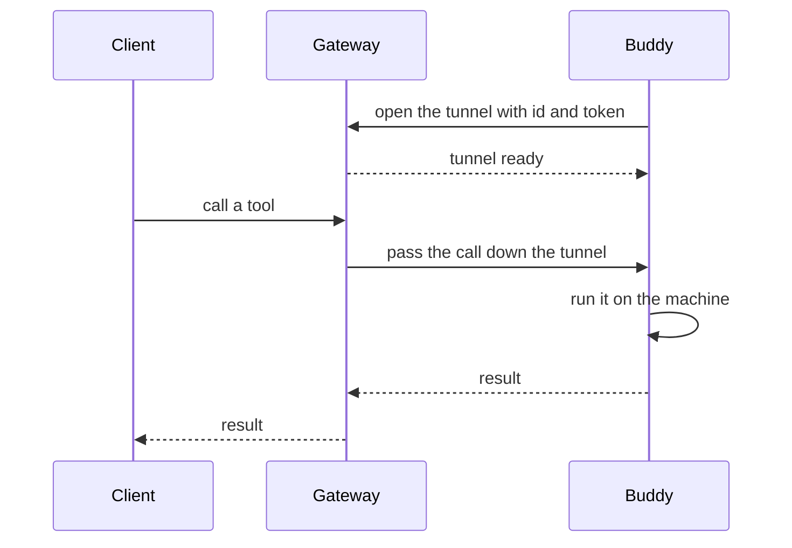

# Buddy

A buddy is a machine made reachable as a set of tools. It runs one small server
that turns the machine's files and shell into tools, and it keeps a tunnel open
to the gateway, so a client can call those tools from anywhere.

## How a call arrives

The buddy opens the tunnel. Your client sends a call to the gateway, and the
gateway passes it down the tunnel the buddy already holds. Nothing reaches the
machine any other way.



The buddy offers `read`, `write`, `edit`, `multi_edit`, the shell tool for
that machine, `grep`, `find`, `ls`, `job` and `mcp`. A call runs on the
machine and the reply comes back the same way.

## Run a buddy

`prime connect` is the short path. It registers this machine as an anonymous
device on the gateway, prints a device ID, a 6-character device code and a
connect URL, then runs the buddy in the foreground. Stop it with Ctrl-C.

```bash
# Connect this machine to the default gateway.
prime connect

# Run the same buddy against a gateway you host.
prime code-mcp --gateway gateway.example.dev --id my-laptop --gateway-token "$TOKEN"

# List the tools a buddy offers.
prime tools list my-laptop

# Call one tool on it.
prime tools call my-laptop.bash '{"command":"uname -a"}'
```

`prime connect` reuses the device it made last time, so one machine keeps one
entry. Add `--new` to register a fresh device. Flags for the buddy itself go
after `--`, as in `prime connect -- --enable-memory`.

To run a buddy without a terminal, install it as a user service with
`prime service install`. It starts at login and restarts if it fails. It reads
its settings from the config, so no credential sits on a command line. On Linux
it stops at logout unless lingering is enabled.

Keep the connect URL and the device code private. They grant shell access to
the machine. An anonymous device has a lower request budget and no file
storage.

## Flags that matter

| Flag | What it does | Default |
| --- | --- | --- |
| `--gateway [url]` | Tunnel through a gateway. A bare flag uses `wss://prime.tuanm.workers.dev`. | no tunnel |
| `--id <uuid>` | The device ID the buddy connects as. | a random UUID |
| `--gateway-token <s>` | Device credential sent to the gateway. Overrides `--token` for the tunnel. | `--token` |
| `--token <s>` | Require a token on every request. Also the device credential unless set separately. | no auth |
| `--port <n>` | Local port for the endpoint. | `7777`, or `$PORT` |
| `--bind <addr>` | Address the local endpoint listens on. | `127.0.0.1` |
| `--enable-memory` | Add the `remember`, `forget` and `recall` tools. | off |
| `--disallowed-tools <list>` | Hide tools by name, comma-separated. | none |
| `--public` | Expose the endpoint through a Cloudflare quick tunnel. Needs `cloudflared`. | off |
| `--domain <host>` | Serve under a hostname you already route to the port. Cannot be combined with `--public`. | none |
| `--mcp <path>` | Add the tools of other servers, read from a config file. | none |

`--token` guards the local endpoint. `--gateway-token` proves the device to
the gateway. Set both when they differ.

## When the network drops

The buddy keeps the tunnel alive with its own small messages, not by
relying on the network to carry a ping. That is what gets through a proxy which
quietly drops an idle connection.

- Every 25 seconds it sends a small keepalive to the gateway.
- If nothing arrives for 75 seconds, it closes the tunnel and reconnects.
- Reconnect waits longer each time, up to 60 seconds, with a little randomness
  so many buddies do not all return at once. It keeps the same device ID, so
  the gateway puts it back in the same slot.
- A drop does not stop the machine. Jobs already running keep running, and the
  local endpoint stays up.
- A call made while the tunnel is down fails at the gateway. Call again once it
  is back.

If the first attempt cannot connect, the buddy prints the likely cause. A
network that inspects TLS needs `NODE_EXTRA_CA_CERTS` set to your root
certificate. A network that needs a proxy needs `HTTPS_PROXY` set before the
buddy starts.

## What it leaves closed

- **No open port.** It does not listen on the network. It binds to loopback by
  default, and the tunnel the buddy opened is the only way in.
- **No unproved call.** Requests to the local endpoint need a token once one is
  set. Calls from a browser always need one.
- **No unproved tunnel.** The gateway checks the device ID and its token before
  it accepts the tunnel. A mismatched pair is refused.
- **No secrets passed down.** Shell tools and added servers do not inherit your
  environment. They get a small set of variables, not keys such as `AWS_*` or
  `OPENAI_API_KEY`.
- **No unbounded input.** Request bodies, tunnel frames and uploads are capped
  in size, so one large call cannot exhaust memory.
- **Not a VPN.** It answers tool calls. It does not forward your traffic or
  open a route to the rest of your network.

## Use cases

- **A long job on the machine you are not at.** Start it with the shell tool,
  then read the output and the exit code from any client. The job keeps running
  when your laptop closes.
- **A file on a home machine, changed from a phone.** A buddy on the machine, a
  client in your pocket. Read the file, edit it, save it. No port opened, no
  VPN.
- **One build machine for a team.** Register it once, then every client that
  holds its token calls the same shell and the same files. None of them touch
  the machine directly.
