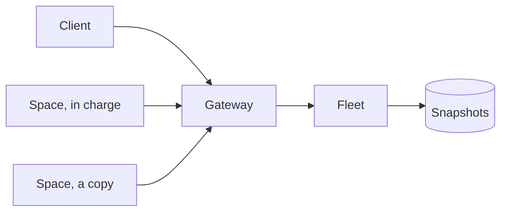
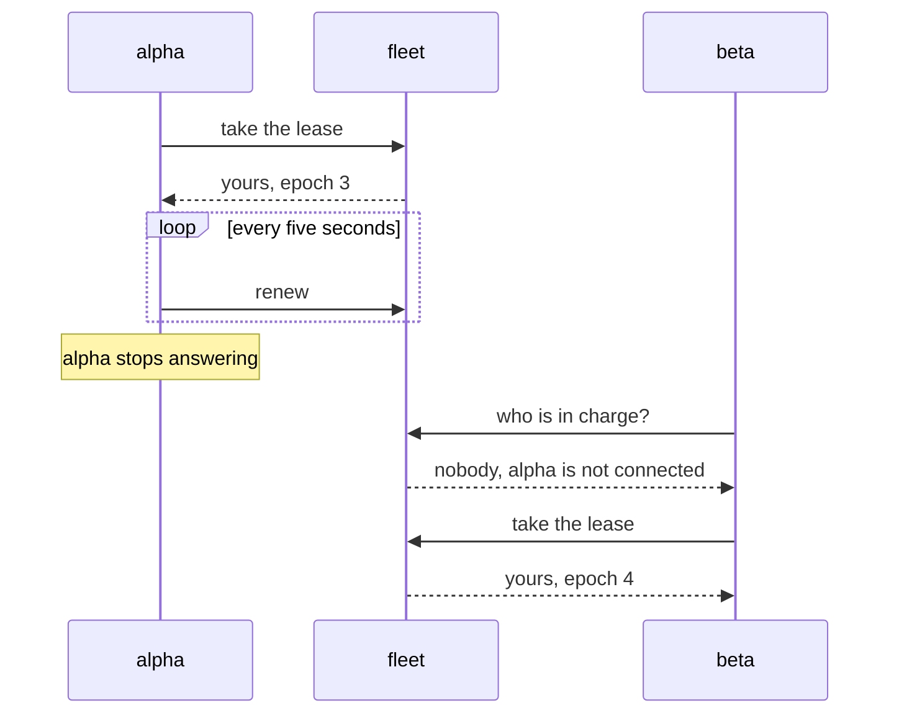
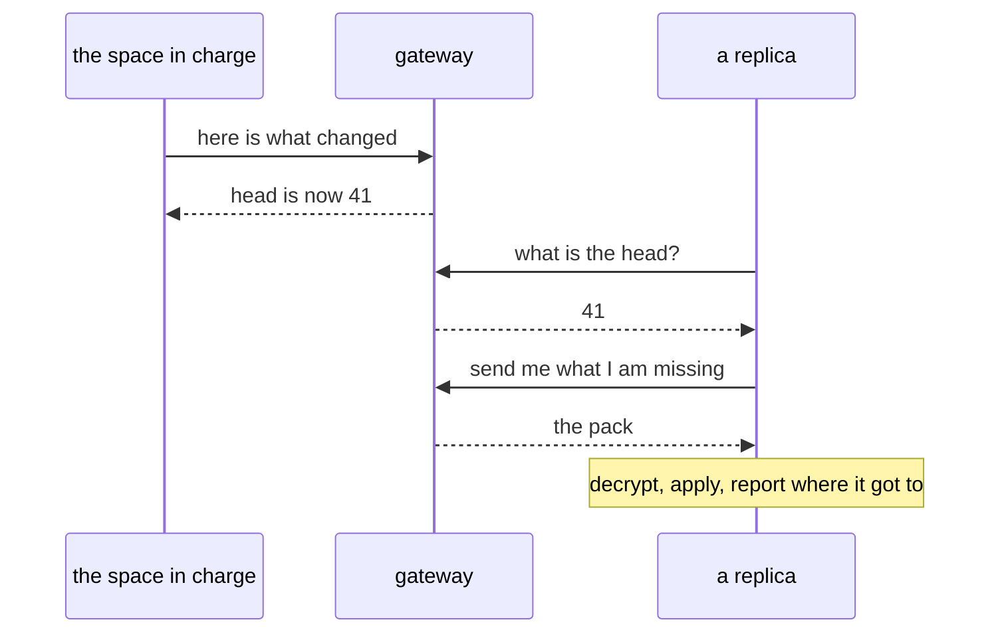

# Fleets

A fleet is a small team of spaces that hold the same work and can take over for
each other. One of them is in charge at any moment - it holds what the fleet
calls the **lease**. The others keep an identical copy and wait their turn.

A fleet is also a device: it answers to its own name, and the operator gives it a
token, so a client can reach the whole fleet without being one of its spaces.



## Why a fleet

A machine goes to sleep, a laptop closes, a container is recycled. A fleet is how
one piece of work survives that: it is in several places at once, and the place
that is answering changes without anybody having to redirect a call.

The work is not copied by hand. Whatever is written in the space that is in
charge is packed, sealed, and carried to the others.

## One is in charge

At any moment exactly one space holds the lease. That one writes. The others are
**replicas**: they keep a copy ready, and they never write.

The lease is short - forty-five seconds - and the one holding it renews every fifteen
(a third of it), on a beat of its own, whatever its rounds are doing: a primary whose
snapshots keep failing (a file it cannot read, a pack the gateway refuses) still holds its
place. A renewal that is lost on the way is tried again two seconds later, and a request for
the place is cut off after ten seconds, so even two failures - each as slow as it may be -
leave a third attempt before the place is gone. A renewal the gateway answered with a refusal
(too many requests, over budget) is not hammered: it is asked again when the gateway said to
(`retry-after`), and in any case within a third of the lease. A space that goes quiet loses
the lease quickly rather than locking the fleet: when it runs out the fleet tells every member
over its socket, and a replica that is current takes over in the rest of the lease plus a few
seconds - about a minute from the holder's last renewal. A request that fails while a replica
is taking over is asked again after a short wait that doubles (three seconds, six, twelve, ...),
not after the replica's usual rest, so one failure costs seconds; a replica that is behind first
has to catch up (see below).



The **epoch** goes up every time the lease changes hands. A space acts only under
the epoch it was given, so a slow publisher from before the change is refused
instead of writing over the state the fleet has moved to.

## What a change does

The space in charge watches its work tree. When something changes it builds a
pack of what is different, seals it for the members' keys, and advances the head.
A replica is told that the head moved, and fetches what it is missing into its own
store in the background (see "A replica does not mirror all the time" below).



The gateway never opens a pack. It is sealed for the members' own keys, so the
gateway carries boxes it cannot read. Nor does a member take its word for what a
box is: see "What the gateway can still do" below.

### A replica does not mirror all the time

A replica does not write what the fleet publishes into its work tree as it arrives.
When the head moves it **fetches**: it downloads the new snapshots, opens them with
its own key, checks each against its manifest and keeps them in prime's object store
beside the work tree. The work tree is written out - once, for however many snapshots
it is behind - only when it has to be:

- when the replica is about to **take over** (the fleet only gives the lease to a
  member that has applied the head), so a replica that is promoted is current before
  it accepts a write;
- when a person runs **`prime fleets sync --space <name>`**, which fetches what is
  missing and applies it;
- the first time, so a member that joins has files to start from.

**A lazy replica's work directory may be behind the fleet, and it is stale by design.**
What it holds is always a snapshot the fleet really had (the last one applied), never
a half-written mix. If something reads a replica's directory and must see the
newest state, run `prime fleets sync`, or set `PRIME_FLEET_REPLICA=mirror` for the
agent: it then writes every snapshot as it is fetched, as replicas did before. The setting is
passed to the agent and written down in its directory (`fleet-agent/settings.json`), so an agent
started by the login service, or restarted after a crash, has it; `prime fleets agent status` says
which mode it is in. See "The agent's settings" below for how they are set, changed and cleared.

The member's state file records both positions: `seq`, `base` and `tree` are what the
work tree holds, and `fetchedSeq`, `fetchedCommit` and `fetchedTree` the newest snapshot
in the store, never behind it. `prime fleets agent status` shows what the agent last did
("fetched 41", "applied 41", "took over at 41").

Fetching is cheap: a replica that is up to date asks nothing, a socket that says "the
head moved" starts one fetch, and the route to the head is the cheapest the replica can
find (see "A replica that fell behind"). A replica takes its place in the fleet when the
agent starts, when the fleet says the lease is free, and as a safety: every fifteen seconds
without a socket (the answer says where the head is, so it asks for nothing else), every five
minutes with one. It does not renew a lease it does not hold.

When the lease is free, replicas that are behind each need to write their work tree to take
it, and only one can. The first to ask is told to catch up and holds a claim on doing so for
thirty seconds (renewed whenever it asks again, but a claim lasts sixty seconds in all); the
others are told to wait, write nothing, and ask again when the claim runs out - and are kept
in the order they asked: when a claim ends the next is given to the one that has waited
longest, and one that asks every second does not overtake one that was told to ask in thirty.
A claimant that died half way costs the others that wait. One that is alive and cannot catch up
- nothing is sealed for it yet, it has lost its key, its work tree cannot be written - has the
claim for its sixty seconds, then goes to the back of the line, and takes it again only if nobody
is waiting; a current client in that state also stops asking for the lease until something
changes. So a replica that can catch up takes over after the claims of the replicas that were
waiting before it: about a minute for each of them that is stuck (measured on the gateway's own
code with a stuck replica ahead of a healthy one: 65 seconds with one stuck, about three minutes
with three), not however many there are. Who actually gets the lease is decided as ever: a
member that has applied the head - a replica that finishes catching up after its claim ended
still takes it.

### What a replica keeps

The fleet carries the files in the primary's work tree, except what git ignores
(`.gitignore`) and except nested git repositories - directories that have their
own `.git`. Those two are never sent, and a directory that was synced and then
became a repository is no longer published (the copies other replicas already
have stay where they are).

When a snapshot arrives, the replica writes the files it has and removes the
files the *previous* snapshot had and this one does not: the ones the primary
deleted. A removal stays inside the work tree (a directory turned into a symlink
is not followed) and only takes a file whose name matches exactly, so a rename
that changes only the case keeps its file on a file system that folds case.

A name is carried as git stores it. On macOS a folder written with a decomposed
accent (`Cafe` plus U+0301, the form HFS+ and some tools produce) reaches the
replicas as the composed `Café` (U+00E9): git's `core.precomposeunicode` makes
that choice for every name it records. Nothing is lost (the files and their
content arrive, in one folder), but the name's bytes on a replica are not always the primary's.

What the fleet never carried is not removed by an apply: git-ignored files
(`.env`, `node_modules`, build output) and nested repositories are untouched.
Two things are not "left alone", and they are not deleted either:

- a file that is not ignored and that the fleet did not give the replica (a note
  someone wrote in the mirror) is a local change, like an edit to a file the fleet
  carries. Before the replica is brought up to date, the changed paths - only
  those - are moved into `local-change-<time>` beside the work tree. A lazy replica does
  that when it is brought up to date (promotion or `prime fleets sync`), not on every head;
- if the fleet turns a directory into a file, git cannot keep both: the ignored
  files inside that directory go with it.

The first snapshot a replica applies has no previous one to compare with. It
removes nothing: a stray file is better than a lost one, and from the second
snapshot on the replica knows exactly what the fleet put there.

### Taking over

A member that has not caught up cannot be promoted: a new space in charge applies
every snapshot up to the head before it accepts a single write. A space in charge
that starts behind the head would fork the fleet, and the fleet refuses it rather
than trusting it.

### A replica that fell behind

Most snapshots carry only what changed. Every 32nd carries the whole tree, as an
anchor - the tree's own files, not the history before it, so its size follows the
tree. A replica that was away starts from the newest whole tree and applies the
changes after it, at most 32 snapshots, however far behind it is. How far behind
one replica is changes nothing for the others: the space in charge goes on
publishing small changes. The gateway keeps the last 64 snapshots, twice the
interval, so the newest whole tree and every change after it are there.

Each snapshot names the head it was built on, whoever published it, so the chain
a replica walks stays whole when the space in charge changes hands. A snapshot
can only be opened by the members it was sealed for; if the chain starts before a
member joined (or before it came back with a new key), it waits for a snapshot
sealed for it - the next change of members, or the next whole tree.

The chain is downloaded and opened before the first step is applied, and each step
is recorded as it is applied. A catch-up that fails part-way leaves a state that
still describes the work tree, so nothing the fleet wrote is taken for a local
change.

A whole tree is also published when a member is added or comes back with a new key (a
swap of one space for another counts), because a snapshot can only be opened by the
members it was sealed for. Each wrapped key says which of the member's keys it is for, so a
member that came back with a new key is routed round the snapshots sealed for its old one. A
member that only left needs no whole tree: the next snapshot is not sealed for it, which is
what keeps it out. A member that has just joined, with nothing yet sealed for it, is told so
after one request and waits for the primary to notice.

**The route a replica takes is the cheapest it can find**: either all the changes since
what it holds, or a whole tree at some checkpoint and the changes after it. Each step
counts its pack's bytes and 24 KB more (two round trips, a manifest, two git processes), so
forty changes of a few hundred bytes are not worth forty round trips when the whole tree is
14 KB, while thirty-nine of 1.5 KB against 1.9 MB are.
A checkpoint carries both - the whole tree, for a newcomer, and the change since the
snapshot before it, sealed with the same key, for everyone who is up to date - so a
replica that follows every snapshot never downloads a whole tree again. The gateway keeps
an index of its snapshots (which are whole trees, how big the packs are), so a replica
works the route out in one request, then fetches the manifests of the snapshots on it
side by side; a gateway without an index is walked manifest by manifest. Older members
ignore the second pack and take the whole tree, as before.

### What the gateway can still do

The gateway stores every manifest in the clear, and decides which one is the head.
So a member does not believe a manifest because the gateway served it. A snapshot is
checked, as it is opened, in three ways (`cli/src/fleet-trust.ts`):

1. **The seal.** The publisher makes a tag (an HMAC, derived from the snapshot key) over the
   fleet, the sequence, the snapshot it follows (the hash its manifest is stored under), the
   commit, the tree, whether the pack is a whole tree, the hash of each sealed pack, its own
   key and the roster, and puts it in the manifest (`seal`). Only a holder of the snapshot
   key can make it, and the snapshot key is only ever wrapped for members. A replica checks
   the manifest against it after it opens the pack, and the pack against the hash in it. A
   manifest the gateway edited, an old snapshot shown under a newer sequence, a tree or pack
   of another snapshot, a snapshot of another fleet: none match, and the snapshot is refused
   before anything is written. (Sizes are not sealed: they only choose the route.) A manifest
   is also read by the hash it is stored under, so the one that comes back is the one that was named.
2. **The sender.** A snapshot's key is wrapped with a key pair its publisher names in the
   manifest. That key has to be one the roster lists (read once, kept in
   `<space>.key.trust.json` beside the key file, and read again only when a snapshot arrives
   from a key that is not in it). Otherwise the gateway could make a key pair of its own,
   wrap a snapshot key of its own for each member and seal its forgery itself.
3. **No going back.** Publishers older than this have no seal, and their snapshots are
   still accepted - but once a member has opened one snapshot with a seal in a fleet
   (the same file records the highest), an unsealed one with a higher sequence is refused.

Whose word this rests on: **the roster**. The operator admits the members, and the
roster says which key each has. The checks hold against anyone who can read and write what
the gateway stores - a bucket, a backup, a replay of old storage, a bug - and against a
gateway that edits or reorders manifests. They do not hold against a gateway that also
lies about the roster: one that adds a key of its own to the list it serves can then
author snapshots. That is visible (`prime fleets members` and the admin page list who is
in), and closing it takes a fingerprint the operator checks outside the gateway.

What the gateway can still do, whatever a member checks:

- **Stop the fleet**: not serve, not store, not move the head.
- **Show an older head** (a rollback): a member sees a snapshot that is real and was the
  head once. It cannot be shown as newer, so a member that holds a higher sequence ignores it,
  but a member that has never seen the newer ones cannot know they exist.
- **Show different members different histories**: each is a real chain; the members
  find out when they take over and publish on a head the others do not have.
- **Roll out slowly**: until every publisher has the seal, a replica that has not yet seen a
  sealed snapshot takes unsealed ones, so an unsealed old snapshot of an old publisher can be
  shown as a new one to a member that never saw a sealed one. And once one is seen, an old
  member that is promoted and publishes without a seal is refused by the new replicas
  ("it carries no seal ... upgrade it"): upgrade every member, then expect no more of that.
  Older replicas read sealed snapshots as they did before (the packs are unchanged; the tag is
  an added manifest field), so mixed fleets keep working in that direction.
- **Know who is in the fleet, how big the work tree is, and when it changes.**

## Joining

The operator makes the fleet - from `/admin`, or with `prime fleets create` where
the gateway token is at hand. Nowhere else: a space cannot bring a fleet into
being. The spaces join, and the operator admits them.

```bash
prime fleets create acme              # the operator makes it
prime fleets invite acme              # a code that works once, for ten minutes
prime fleets join acme --code p1_...  # a space asks to join
prime fleets pending acme             # who is waiting
prime fleets approve acme --member <id>   # let it in
prime fleets members acme             # the roster
```

The invite makes the admission deliberate:

- **one code, one device**, whether or not approval follows;
- **ten minutes** by default, an hour at most;
- **stored as a hash**, so a dump of the store yields no usable code;
- **an invitation, not an identity** - it says somebody was asked, not who is
  holding it. That is why the operator sees the request and approves it.

A space that asks to join waits. Its agent keeps asking until it is let in.

## Use cases

- **A repository that follows you.** A fleet of three spaces on three machines,
  all holding the same checkout. Start a long job on any of them; when that
  machine stops, the next one carries on from the same point.
- **A workspace that survives a laptop.** The desktop holds the lease, the laptop
  and the space on a server keep copies. Close the lid, keep working.
- **One address for a whole team of machines.** Give the fleet a token, and a
  client that knows nothing about its spaces can run a tool on the fleet as if it
  were one machine.

## Talking to a fleet

The fleet is a device with its own name, so a client reaches it the way it
reaches any device:

```bash
prime tools call --device acme --token <fleet-token> bash '{"command":"ls"}'
prime tools call fleet:acme.bash '{"command":"ls"}'    # from inside a space of the fleet
```

The call goes to whichever space holds the lease, and the answer comes back the
same way. Nobody has to know which machine ran it.

A **member** may also address the fleet through its own device token: the fleet
checks membership instead of the fleet token. And a space that has stopped its
agent stops holding the lease, so a call made in the gap fails with a plain
"no primary right now" rather than hanging.

### Only the space in charge is entered

`prime spaces enter` works on any space that is not in a fleet. In a fleet it
works only on the space in charge: a fleet is several copies of one piece of
work, and an edit made in a replica is moved aside the next time it is brought up to date.

The answer comes from the fleet, not from the configuration file, so a space that
has just taken over can be entered at once.

## In the admin page

Each fleet is a card, with its spaces under it. The marks say what is going on:

| mark | means |
|---|---|
| cloud filled | a token, not paused, and a space holds the lease |
| cloud outline | one of those is missing: no way in |
| green border | that space holds the lease |
| red ring | that space is not connected |
| grey card | the operator switched it off |
| dashed card | a space asking to join, with Admit and Decline |

Beside the fleet tree, **Buddies** carries a row for the fleet itself: its name -
the id a client uses - and its token, masked, with a short fingerprint of it in
the tooltip. The gateway keeps only that fingerprint, never the token.
**Refresh token** makes a new one and shows it once, because there is no second
chance.

## Three credentials, three jobs

| Credential | Belongs to | Can do |
|---|---|---|
| gateway token | the operator | create fleets, mint invites, admit and remove |
| device token | one device | speak for that device: join, sync, take the lease |
| fleet token | one fleet | reach the fleet and nothing else: it cannot join, admit or publish |

The fleet's token belongs to the fleet, not to any space. No member ever uses it.
It is what a client that is not a member presents, and it carries exactly one
right: talking to the fleet.

A secret every member shares would mean every member could act as every other,
and revoking one would rotate it for all. Per-device tokens give per-member
leases, per-member revocation, and a name to look at when something went wrong.

## What happens when it goes wrong

| Situation | What the fleet does |
|---|---|
| the space in charge stops | it gives up the lease at once; the next member that asks takes over |
| its tunnel goes away | the next ask finds the holder not connected and takes it out of the running; a waiting member asks every fifteen seconds without a socket, every five minutes with one, so it is the lease running out (and the socket telling everyone) that usually decides - within a minute |
| the operator switches a space off | the same, at once; it stays a member until it is removed |
| the operator pauses the fleet | nothing joins, nobody takes a place, nothing is published; members stay, the lease runs out. The agents are told over their socket and stop asking, so a paused fleet costs the gateway nothing until it is resumed |
| the operator resumes it | the agents are told at once and a primary is back in about a second |
| the agent's socket drops, or the gateway has none | the agent falls back to asking, as it always did; it looks for the socket again by itself |
| no member holds the lease | the next member whose agent asks takes it; a call in that gap is refused with "no primary right now" |
| the holder's agent stops | its place lapses when the lease runs out (forty-five seconds after its last renewal); the fleet tells the members over their socket, and one takes it a few seconds later |
| the holder's machine reboots | the same, and the reason the agent belongs in a service: `prime fleets agent install` |
| a fleet has no token | no client can reach it; members still sync |
| the invite expired or was used | the request is refused, and the code is gone |
| the fleet is full | refused, at thirty-two members |
| the owner leaves | the fleet goes to the member that has been in it longest, and is gone with the last one |
| a fleet nobody has touched for a day | any proven device may clean it up |
| the name a fleet wants is a device's | refused: a fleet is reached under its own name, so the two must not collide |
| two spaces would share a name | the second is refused when it asks to join, and told to pass `--name`; names are compared without case |
| a member comes back with a new key | the fleet learns it when the member takes its place, and seals the next snapshot for it |
| a replica's work tree was edited locally | the paths that differ from what the fleet gave it - and only those; ignored files and nested repositories are not touched - are moved aside into `local-change-<time>` beside the work tree when the replica is next brought up to date (a promotion, `prime fleets sync`, or every head in `mirror` mode): a replica that cannot catch up is a fleet that cannot promote it |
| no member can be promoted | every member is behind the head (each one was edited and could not sync); the move above is what lets them catch up again |

## The agent belongs in a service

The agent renews this machine's place in the fleet every fifteen seconds while it holds
the lease, and keeps a replica's copy fetched. It is what keeps the fleet alive: while
it runs, the space holds the lease or has a copy ready to take it; while it does not,
the place lapses and the fleet waits for someone else to take it.

So it has to outlive the terminal that started it, and the reboot:

```bash
prime fleets agent install      # a login service: starts at login, restarts if it stops
prime fleets agent status       # rounds, the last thing it did, and whether it is a service
```

The lease and the heartbeat are two numbers that have to agree. The heartbeat is
a third of the lease the fleet reports, a renewal that is lost is tried again after two
seconds, and one the gateway refused after the time it named (never more than a third of the
lease later), so more than one can fail before the place is gone - and a fleet keeps
answering its clients meanwhile. The beat does not wait for the rounds: it renews even when
the rounds are failing.

### The agent's settings

Four things can be set for the agent, in the shell that runs `prime fleets agent start`
(or `install`): `PRIME_FLEET_REPLICA` (`lazy` or `mirror`), `PRIME_FLEET_CACHE_MB`,
`PRIME_FLEET_POLL_MS` and `PRIME_FLEET_HEARTBEAT_MS`. They are written down in
`fleet-agent/settings.json`, so the login service, and an agent restarted after a crash, run
with the same.

- A value that means nothing (`sideways`, `-3`) is ignored.
- A clean shell changes nothing: what was saved stands. To go back to a default, name the
  variable empty (`PRIME_FLEET_REPLICA= prime fleets agent start`), or forget everything with
  `prime fleets agent reset`.
- `agent start` with a setting that differs from the one the running agent has restarts it. Several
  `agent start`s at the same time are fine: each writes its own temporary file, the lock lets one
  agent through, and the ones that lose it exit at once (they are started without waiting for the lock).
  Commands that only need an agent running, like `prime spaces create`, neither save what their
  shell exports nor restart it *for that*; they do restart it when the saved settings differ from
  the running agent's (for example right after `agent install` saved new ones).
- There is one login service per machine, and it runs the one configuration it was installed
  with (`--config`; `prime fleets agent status` prints it, and `status --json` has a `service`
  object). For that configuration (macOS, Linux), when its manager answers, the manager is what
  starts the agent: `agent start`, `spaces create` and a settings change ask it to start or
  restart it, and no agent is spawned beside it. An agent that was started by hand and is running
  when the service is installed (or is found beside it later) is stopped first, and `agent install`
  does the same, except for the service's own agent, which the manager replaces. If the manager
  cannot be reached (no login session on a headless machine, no user bus, a service file left by an
  install that failed) the service counts for nothing: the agent is handled directly, as if it
  were not installed. If the manager answers and will not restart a running agent, the command
  says so and the agent keeps the settings it has.
  For any other configuration (`--config`, `PRIME_CONFIG`) the service is not its own: its agent
  is started, stopped and restarted directly, `agent status` says which configuration the service
  runs, `agent install` is refused while it runs another, and `agent uninstall` is refused too
  unless `--force` is given (remove the service from the configuration it runs, or force it).
  A definition that does not say (a hand-edited unit, a binary plist) is taken for the default
  configuration's.
- One agent runs per configuration: a second one that is started exits, saying who holds the
  lock (`fleet-agent/agent.lock`, which the running agent touches every few seconds). A stopping
  agent is given ten seconds to let go. The lock names its holder, and where the process list
  cannot say what a pid is (Windows, or where neither `/proc` nor `ps` can see the process), a fresh lock that names the pid, or
  for an agent of a build from before the lock a fresh `state.json` that names it, is what counts.
  So the upgrade is: `prime fleets agent stop` (it stops an old agent too), then start the new one;
  `agent install` does the stop for you.

A member holds its place only while the gateway can see its device tunnel: a holder whose
device is not connected is taken out of the running the next time anyone asks. Spaces always
have a tunnel (`prime code-mcp --gateway ...`); an agent started on its own, without one, will
find the lease moving between members every few seconds. Run it beside a tunnel, or not at all.

## What it costs

A fleet is the expensive part of the gateway: its agents send a request every
few seconds, and each one is a request to an object, so the bill is mostly
object requests. An object is billed for its time only while it is working; one
that waits on a hibernated socket costs nothing.

An agent that can **listen** does not ask. It keeps one socket to its fleet, and the
fleet says when something happens: a new snapshot, the lease free, a pause, a resume.
The ping that keeps the socket honest is answered by the runtime without waking the
fleet, and an object with nothing to say is allowed to sleep. So while a fleet is
**paused** the gateway sees no request at all from its members, apart from one now and
then to renew the socket. Measured against a live gateway, three spaces over ninety
seconds:

| | requests to the Worker | requests to objects |
|---|---|---|
| paused, agents that ask (before) | 114 | 200 |
| paused, agents that listen | 4 | 0 |

A running fleet still sends the requests that are its work: the primary renews the
lease (every fifteen seconds) and publishes, the others fetch what was published. An idle
replica that does not mirror sends almost none: with a socket it asks for its place every
five minutes and looks at the head every ten (about 430 requests a day, where it was about
11,500); without a socket it asks for its place every fifteen seconds and the answer carries
the head (about 5,700, where it was about 132,000). A replica that mirrors, and so wants a
fresh work tree, looks at the head every round without a socket (about 63,000) and every
thirty seconds with one (about 3,100).

What a snapshot costs on the wire (2,000 files, 3.9 MB, one file edited per snapshot, a
replica that follows every one):

| | before | now |
|---|---|---|
| a snapshot, up | 2.0 KB | 2.0 KB |
| the checkpoint (every 32nd), up | 1.91 MB | 1.88 MB tree + 2 KB change |
| the checkpoint, a replica that is up to date, down | 1.91 MB | 2.8 KB |
| a snapshot while one member is far behind, up | 1.92 MB, each time | 2.0 KB |
| a member 39 snapshots behind catches up, down | 1.92 MB, 4 requests | 62 KB, 81 requests |

The gateway counts what it does - requests, how long each object was busy
serving them, the objects stored and read - and prices them at Cloudflare's list prices with
the free allowances taken off. `/admin` shows the month, the cost and what it is
made of.

The ceiling is `FLEET_MONTHLY_BUDGET_USD`, twenty dollars by default. At the
ceiling the fleet routes answer **402** and say so. The admin page keeps working,
because the operator has to be able to see the number that stopped it and raise
it, and so does everything that is not a fleet.

## Limits

| | |
|---|---|
| members per fleet | 32 |
| invite lifetime | ten minutes by default, one hour at most |
| lease | forty-five seconds, renewed every fifteen |
| snapshot | a thin delta pack per head; a whole tree every 32nd, and when the members change |
| snapshots kept | the last 64 |
| a member's object store | collected the first time it passes 32 MB or `PRIME_FLEET_CACHE_MB` (512 by default), and again after it has grown by 64 MB or by half of what the last collection left; it keeps the snapshot the work tree holds, the newest fetched and what its indexes name, so a work tree bigger than the cap leaves it over the cap |
| `PRIME_FLEET_REPLICA` | `lazy` (the default: fetch ahead, apply when needed) or `mirror` (apply every snapshot as it is fetched) |
| `PRIME_FLEET_POLL_MS`, `PRIME_FLEET_HEARTBEAT_MS` | how often a replica looks at the head (1500 ms) and how long the primary waits between renewals at most (15000 ms; the fleet's own lease can lower it); saved like the others |
| a fleet nobody touches | cleaned up after a day |

## Where to read more

- [Join](https://prime.tuanm.workers.dev/join) - the same story with a picture
- [The gateway](../api/README.md) - how a call travels, and what the endpoints are
- [The CLI](../cli/README.md) - every fleet command
