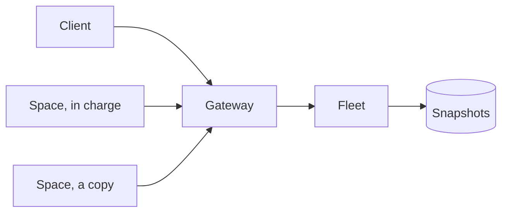
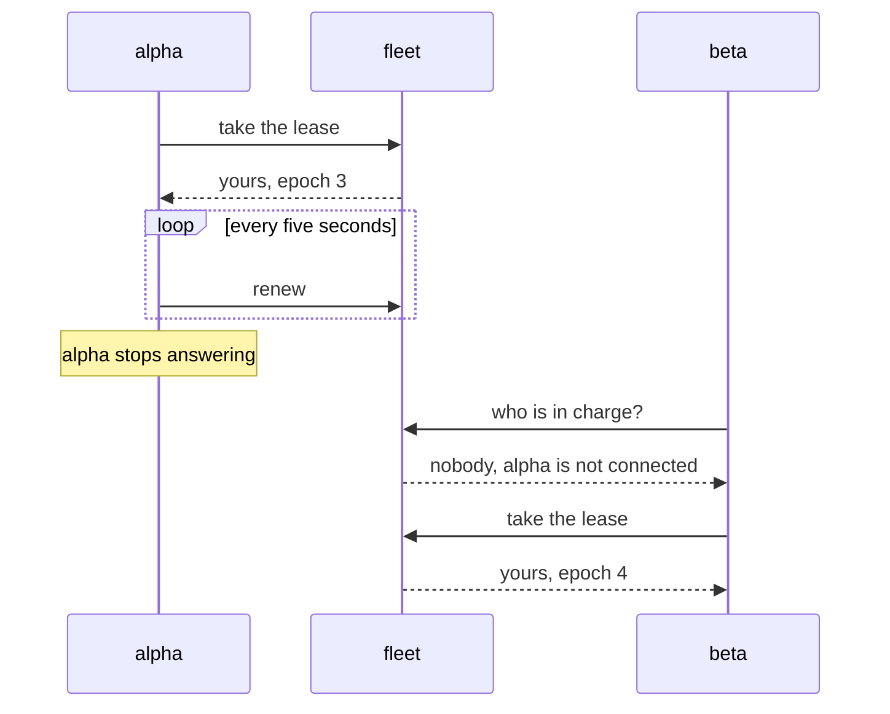
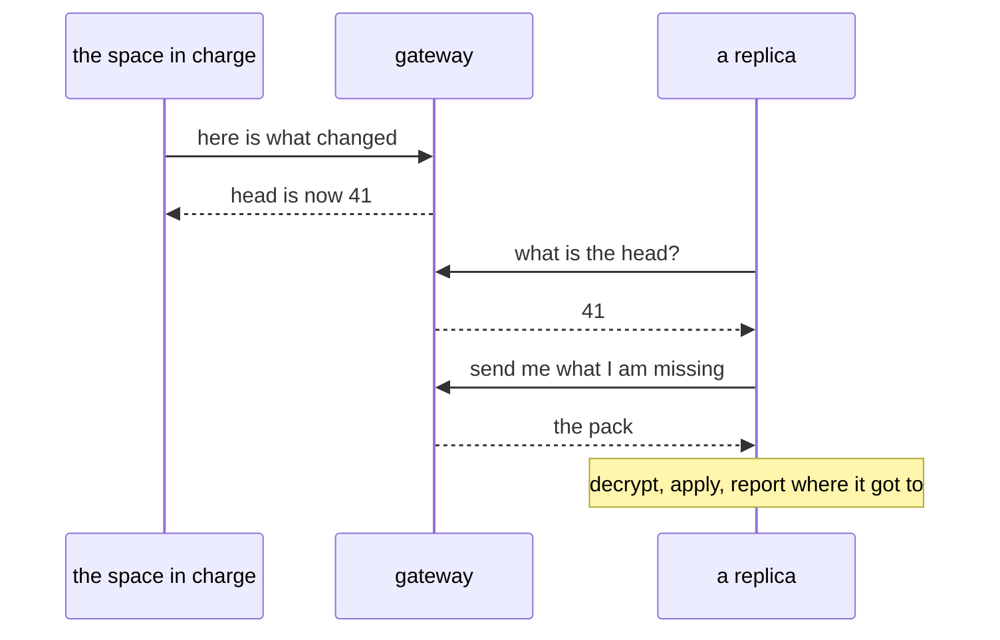

# Fleets

A fleet is a small team of spaces that hold the same work and can take over for
each other. One of them is in charge at any moment - it holds what the fleet
calls the **lease**. The others keep an identical copy and wait their turn.

A fleet is also a device: it answers to its own name, and the operator gives it a
token, so a client can reach the whole fleet without being one of its spaces.



## Why a fleet

A machine goes to sleep, a laptop closes, a container is recycled. A fleet is how
one piece of work survives that: it is in several places at once, and the place
that is answering changes without anybody having to redirect a call.

The work is not copied by hand. Whatever is written in the space that is in
charge is packed, sealed, and carried to the others.

## One is in charge

At any moment exactly one space holds the lease. That one writes. The others are
**replicas**: they mirror, and they never write.

The lease is short - fifteen seconds - and the one holding it renews every five,
so a space that goes quiet loses it quickly rather than locking the fleet.



The **epoch** goes up every time the lease changes hands. A space acts only under
the epoch it was given, so a slow publisher from before the change is refused
instead of writing over the state the fleet has moved to.

## What a change does

The space in charge watches its work tree. When something changes it builds a
pack of what is different, seals it for the members' keys, and advances the head.
A replica asks what the head is, and pulls what it is missing.



The gateway never opens a pack. It is sealed for the members' own keys, so the
gateway carries boxes it cannot read.

A member that has not caught up cannot be promoted: a new space in charge applies
every snapshot up to the head before it accepts a single write. A space in charge
that starts behind the head would fork the fleet, and the fleet refuses it rather
than trusting it.

## Joining

The operator makes the fleet - from `/admin`, or with `prime fleets create` where
the gateway token is at hand. Nowhere else: a space cannot bring a fleet into
being. The spaces join, and the operator admits them.

```bash
prime fleets create acme              # the operator makes it
prime fleets invite acme              # a code that works once, for ten minutes
prime fleets join acme --code p1_...  # a space asks to join
prime fleets pending acme             # who is waiting
prime fleets approve acme --member <id>   # let it in
prime fleets members acme             # the roster
```

The invite makes the admission deliberate:

- **one code, one device**, whether or not approval follows;
- **ten minutes** by default, an hour at most;
- **stored as a hash**, so a dump of the store yields no usable code;
- **an invitation, not an identity** - it says somebody was asked, not who is
  holding it. That is why the operator sees the request and approves it.

A space that asks to join waits. Its agent keeps asking until it is let in.

## Use cases

- **A repository that follows you.** A fleet of three spaces on three machines,
  all holding the same checkout. Start a long job on any of them; when that
  machine stops, the next one carries on from the same point.
- **A workspace that survives a laptop.** The desktop holds the lease, the laptop
  and the space on a server keep copies. Close the lid, keep working.
- **One address for a whole team of machines.** Give the fleet a token, and a
  client that knows nothing about its spaces can run a tool on the fleet as if it
  were one machine.

## Talking to a fleet

The fleet is a device with its own name, so a client reaches it the way it
reaches any device:

```bash
prime tools call --device acme --token <fleet-token> bash '{"command":"ls"}'
prime tools call fleet:acme.bash '{"command":"ls"}'    # from inside a space of the fleet
```

The call goes to whichever space holds the lease, and the answer comes back the
same way. Nobody has to know which machine ran it.

A **member** may also address the fleet through its own device token: the fleet
checks membership instead of the fleet token. And a space that has stopped its
agent stops holding the lease, so a call made in the gap fails with a plain
"no primary right now" rather than hanging.

### Only the space in charge is entered

`prime spaces enter` works on any space that is not in a fleet. In a fleet it
works only on the space in charge: a fleet is several copies of one piece of
work, and an edit made in a replica is thrown away the next time it mirrors.

The answer comes from the fleet, not from the configuration file, so a space that
has just taken over can be entered at once.

## In the admin page

Each fleet is a card, with its spaces under it. The marks say what is going on:

| mark | means |
|---|---|
| cloud filled | a token, not paused, and a space holds the lease |
| cloud outline | one of those is missing: no way in |
| green border | that space holds the lease |
| red ring | that space is not connected |
| grey card | the operator switched it off |
| dashed card | a space asking to join, with Admit and Decline |

Beside the fleet tree, **Buddies** carries a row for the fleet itself: its name -
the id a client uses - and its token, masked. **Refresh token** makes a new one
and shows it once, because there is no second chance.

## Three credentials, three jobs

| Credential | Belongs to | Can do |
|---|---|---|
| gateway token | the operator | create fleets, mint invites, admit and remove |
| device token | one device | speak for that device: join, sync, take the lease |
| fleet token | one fleet | reach the fleet and nothing else: it cannot join, admit or publish |

The fleet's token belongs to the fleet, not to any space. No member ever uses it.
It is what a client that is not a member presents, and it carries exactly one
right: talking to the fleet.

A secret every member shares would mean every member could act as every other,
and revoking one would rotate it for all. Per-device tokens give per-member
leases, per-member revocation, and a name to look at when something went wrong.

## What happens when it goes wrong

| Situation | What the fleet does |
|---|---|
| the space in charge stops | it gives up the lease at once; the next member that asks takes over |
| its tunnel goes away | the next ask finds the holder not connected, takes it out of the running, and the waiting member takes over in a second or two |
| the operator switches a space off | the same, at once; it stays a member until it is removed |
| the operator pauses the fleet | nothing joins, nobody takes a place, nothing is published; members and leases stay |
| no member holds the lease | the fleet says so; a call is refused with "no primary right now" |
| a fleet has no token | no client can reach it; members still sync |
| the invite expired or was used | the request is refused, and the code is gone |
| the fleet is full | refused, at thirty-two members |
| the owner leaves | the fleet goes to the member that has been in it longest, and is gone with the last one |
| a fleet nobody has touched for a day | any proven device may clean it up |
| the name a fleet wants is a device's | refused: a fleet is reached under its own name, so the two must not collide |
| two spaces would share a name | the second is refused when it asks to join, and told to pass `--name`; names are compared without case |
| a member comes back with a new key | the fleet learns it when the member takes its place, and seals the next snapshot for it |

## What it costs

A fleet is the expensive part of the gateway: its agents keep the objects awake
and send a request every few seconds, so the bill is mostly object minutes, not
traffic.

The gateway counts what it does - requests, the minutes each object was awake,
the objects stored and read - and prices them at Cloudflare's list prices with
the free allowances taken off. `/admin` shows the month, the cost and what it is
made of.

The ceiling is `FLEET_MONTHLY_BUDGET_USD`, twenty dollars by default. At the
ceiling the fleet routes answer **402** and say so. The admin page keeps working,
because the operator has to be able to see the number that stopped it and raise
it, and so does everything that is not a fleet.

## Limits

| | |
|---|---|
| members per fleet | 32 |
| invite lifetime | ten minutes by default, one hour at most |
| lease | fifteen seconds, renewed every five |
| snapshot | a thin delta pack per head |
| a fleet nobody touches | cleaned up after a day |

## Where to read more

- [Join](https://prime.tuanm.workers.dev/join) - the same story with a picture
- [The gateway](../api/README.md) - how a call travels, and what the endpoints are
- [The CLI](../cli/README.md) - every fleet command
